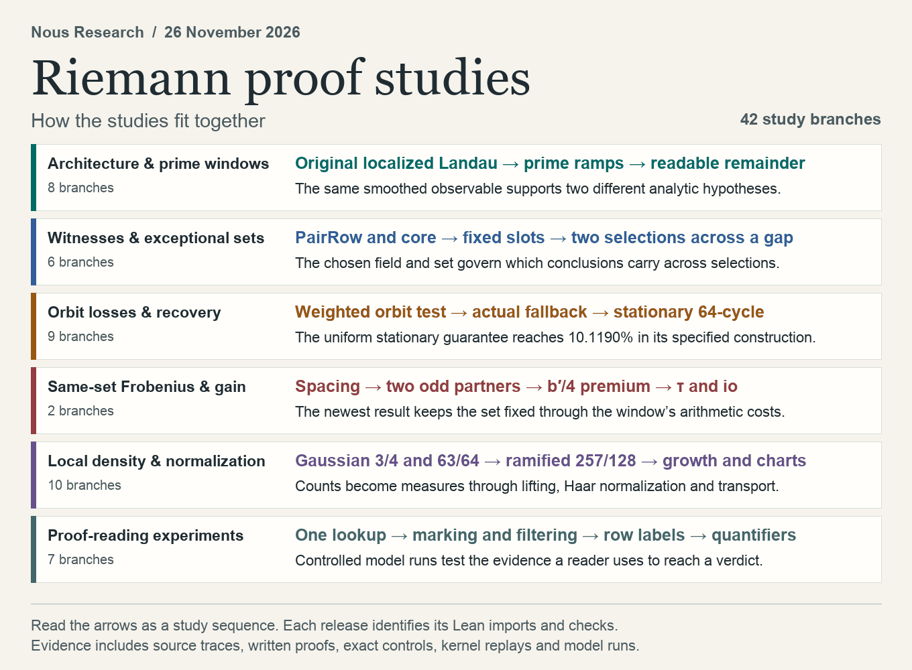

# Riemann proof research workspace

This directory contains our reading notes and prospective experiments on Levent Alpöge's Riemann Hypothesis formalization and the community's subsequent verification and simplification work.

Start with [PROOF_CONTEXT.md](PROOF_CONTEXT.md), which reconstructs selected analytic, arithmetic, cohomological, and covolume arguments at the original source pin. Its companion traces and [SOURCE_TRACE.json](SOURCE_TRACE.json) record the inspected declarations. The earlier [RESEARCH_NOTES.md](RESEARCH_NOTES.md) is retained as an initial, more limited reading. Import provenance is recorded in [PROVENANCE.json](PROVENANCE.json).

## Study portfolio

[Browse the research map and study index](portfolio/README.md). The portfolio covers 42 experiment branches, with exact Git pins for each release and reading paths through the six research questions.

The latest study follows the same-set Frobenius premium through the original arithmetic window. [Paper, Lean replay and exact controls](https://github.com/nousentllc/riemann-hypothesis/tree/80555206be28204b1d0a9063f54c8f1e2b5fd70d/research/uriel/experiments/frobenius-window-survival).

## Baselines

- **Published proof:** `40e56bab026552e089d7afcfeff08d2defb9c005` in the upstream Git history. This is the original source release, written for Lean 4.33.1.
- **Community development:** the separately recorded upstream commit at import. This branch has changes after the original release, including source reduction and toolchain updates. Read its own `lean-toolchain` and `lake-manifest.json`.
- **Our research:** notes and experiments under `research/uriel/`, on `research/uriel`. New notes do not alter the original mathematical proof or constitute an independent check of it.

The original source remains reachable through Git history and a dedicated local branch. Do not equate a community checkout or one of our research commits with the original release.

## Initial reading phase · 22 November 2026

The initial task was a deeper mathematical reading of the proof. Proposed applications to AI memory, representation, or governance are deferred until the relevant arguments and assumptions are understood.

The initial notes reconstruct the Mellin-transform and localized-Landau mechanism, the actual arithmetic error bracket and exponent losses, a projection/slope/covolume subargument, and the finite-exception logic behind cohomological windows. They also identify the deeper automorphic and arithmetic-geometric dependencies that remain only traced.

The original source is always read at its pinned commit. A source reading, an algebraic check, a proved conditional implication, and an independently replayed complete proof are recorded as different levels of evidence.

## Verification at import

This import is source preservation and selected source inspection. We have not run the complete Lean build or independently checked the entire exported proof. The [Lean and Mathlib joint statement](https://leanprover-community.github.io/blog/posts/riemann-hypothesis/) and [Andrew Sutherland's verification records](https://math.mit.edu/~drew/grh/) describe external verification of the original submission.

A source checkout, a successful download, and a matching Git commit are not a proof-verification run. Before undertaking verification, use the instructions and dependency pins belonging to the exact baseline selected. Full builds require substantially more resources than reading the source.

## Attribution

The proof was announced by Levent Alpöge, working with Claude, on 20 November 2026. Upstream commit authorship and notices are retained. The upstream README states that the submission was published without a license and is mirrored for verification. This research directory does not assign a new license to the imported proof or its supporting third-party material.

Our reading notes were prepared with Uriel on 22 November 2026.
