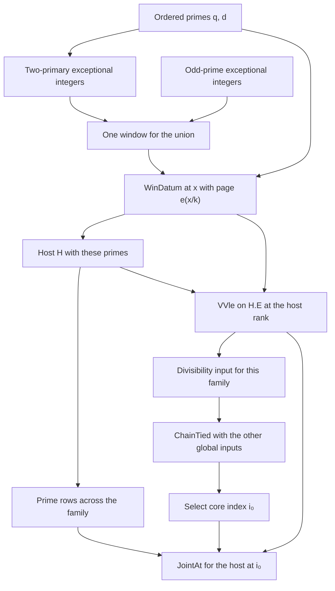

# One prime row, one cohomological bound, one core host

This experiment follows the primitive-character argument at the published commit `40e56bab026552e089d7afcfeff08d2defb9c005`. Fix a character $\psi$ and a sufficiently small $\varepsilon$. The source constructs a common good interval for exceptional integers, uses the bound on that interval for a field with the chosen ordered primes, and passes a property of every late family index to the particular host selected for the core.

## The witness through the proof

| Stage | What becomes fixed | What passes to the next stage |
|---|---|---|
| Select a pair | After fixing the outer scale $X$ and $T=X^{1/J}$, choose $q$ and then $d$ with `PairGood`. | The very same $q,d$ enter the call that supplies the cohomological window. |
| Select one interval | A two-primary field for this pair supplies a bounded set $E_2$. The odd-prime estimates supply sets $E_\ell$ for the specified auxiliary fields. Select $W$ for their union. | For every $z\in[W,W^2]$ and every integer $a$ in that union, $a\le z^{C_t}$ implies $a\le z^\eta$. Restriction gives both component estimates at the same $z$. Small exceptional integers are allowed. |
| Match the field | In the rescaled window use $z=x/k$ and the page $e(z)$. The field constructor returns a host whose frame exponent and primes agree with $e(z),q,d$. | Rewriting those equalities lets `hW.bound H.E hCF` supply `VVle` for the very field $H.E$. The rank-height estimate permits restriction to $R.t$. |
| Assemble one family | Host requirements transfer through the point-from-host equalities; `GChi.cls` gives the cohomological bound at **every** late index. The design also carries `QDRowsF`, a row at every sufficiently late index. | `topDesWin` applies `divinN_of_hypV` in that same family. This yields the divisibility input to the global chain together with the other, independently required links. |
| Extract the core | At an admissible late $x$, `tiedCore_of_chainTied` returns an index $i_0$ and proves that the chain's retained set is the host's actual `TT`. | Instantiate both all-index properties at $i_0$. This yields a single host with a prime row, a cohomological bound at its own field and rank, and `CoreAtH` at its own retained set. |

The core's `TT` and `T2` are sets in the frame group. The exceptional sets contain natural-number exponents used earlier to establish `VVle`. Recovering their entries would require the chosen fields and their ultrametric centers. The proof exports the bound. The pair-scale witness supplied by `QDRowsF` can also be chosen existentially. Nothing in this reconstruction equates two independent selections of $Y$ or promises a canonical pair at a real scale. [Exceptional-set trace](EXCEPTIONS.md) · [Host and index trace](ROW.md) · [Family projection](FAMILY_ROW.md)

## What can be computed

With $\varepsilon=1/64$ and $T=2^{48}$, the exact numerical row $q=3$, $d=6826(2^{1279}-1)+1$, $n=2^{306}$ meets all 11 `Rowq` clauses. A supplied two-label example gives $W=2^{96}$ and a test point $x=2^{144}$. Removing a label invalidates the selected interval. The conductor-one character actually has **two odd auxiliary indices, 3 and 7**, in addition to the two-primary component. Determining these indices does not give their exceptional integers. [Registered protocol](COMPUTE_PROTOCOL.md) · [Numerical results and controls](COMPUTATION.md) · [Conductor-one calculation](conductor_one.json)

The attempt to extend this numerical row to a host stops at identifiable source conditions. Its $\log(qd)>896$ exceeds the permitted $2^{3/16}<2$. Its $q=3$ is excluded by the later field construction. For every dyadic $T=2^a$ from $a=48$ through $36{,}126$, the lower edges of the prime boxes alone already force failure of this log bound. At $a\ge37{,}550$ their upper edges suffice for this particular condition. No numerical instance of the source's `CoreAtH` was produced. [Scalar obstruction and boundary certificates](THRESHOLD.md)

One can go further if the centers are supplied. At $Z=64$, fifteen explicit rational $p$-adic centers at the slots 2, 3 and 7 give the seven exceptional weights $\{1,7,28,41,43,56,64\}$. Direct valuations and congruences agree at every center. With $C_t=1$ and $\eta=1/128$, the entire interval $[2,4]$ satisfies the window condition. On $[8,64]$ it fails at $x=8$ for weight 7. The source obtains its own centers from a field-dependent existence theorem and uses $C_t=401$ in the character application. [Finite filter, boundary control and complete outputs](CENTER_FILTER.md)

## What Lean checks

Three complementary statements isolate witness identity. The fixed-pair theorem moves $q,d$ outside the quantifier over the window using the source proof. The same-index theorem transfers one explicitly retained row, including its $Y$, between indices of a fixed late family. The design theorem keeps the original design's row predicate alongside the character class, then extracts a joint witness at all sufficiently late member scales. The resulting statements are conditional on their displayed source hypotheses. [Fixed pair and quantifier control](FixedPair.lean) · [Transfer of a named row](SameIndex.lean) · [Design projection](OriginalDesign.lean) · [Joint conclusion](JointControls.lean) · [Verification and reproduction](REPRODUCE.md)

The numerical protocol was committed locally before running the prime search. The conductor-one index calculation, rescaling control, box thresholds and strengthened Lean statements are follow-up tests. The lightest reproduction uses only standard-library Python. [Main protocol](PROTOCOL.md) · [Source text checks and mutation tests](TRACE.md)
