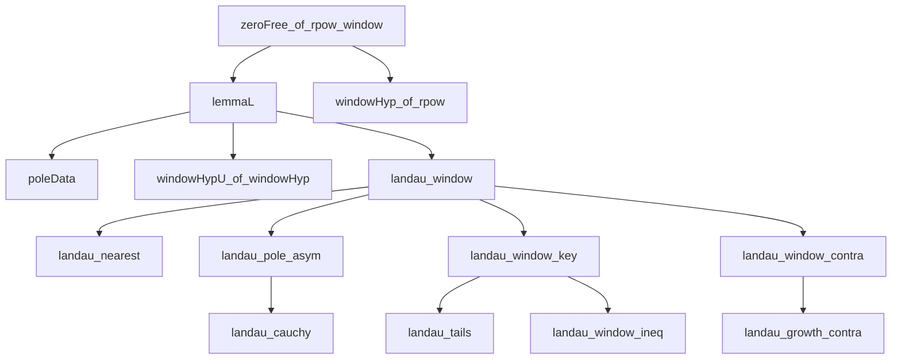

# The scoped Lean verification

The local target is `Deduction.zeroFree_of_rpow_window`. For a finite admissible character family with positive weights, $0<\theta<1$ and $\delta>0$, its hypothesis is
$\forall Y_0\;\exists Y\ge Y_0\;\forall y\in[Y,Y^{1+\delta}],\ G_m(F,y)\le C y^\theta$. Its conclusion is the source's `ZeroFree F θ`. The experiment checks the proof of this **conditional implication**. Supplying the window hypothesis for the families needed by the headline theorems is a separate part of the formalization. [Conditional theorem](https://github.com/nousentllc/riemann-hypothesis/blob/40e56bab026552e089d7afcfeff08d2defb9c005/src/Development/AutomorphicArithmetic/DedekindLFunctions/LandauTheorems/ZeroFreeOfRpowWindow.lean#L11-L14) · [Family and conclusion](https://github.com/nousentllc/riemann-hypothesis/blob/40e56bab026552e089d7afcfeff08d2defb9c005/src/Development/AutomorphicArithmetic/DedekindLFunctions/CharFamily.lean#L24-L47)

## What was checked

All 30 original project modules in the target's local import closure compiled from their pinned source. All 30 passed individual Lean kernel replay. The three excerpted declarations and the new coefficient theorem passed their separate wrapper checks. [Coverage and object digests](results/formal_summary.json)

| Material | Local evidence | Scope |
|---|---|---|
| Original analytic source | Compilation from pinned Git blobs followed by individual `leanchecker -v` invocations | The project import closure of the conditional endpoint |
| Three extracted proofs | Byte-exact declaration blocks, compiled and replayed in one fresh Mathlib wrapper | The arithmetic interval selector `UpperTheory.V.Win.window1`, `GlobalTheory.CutNum.numeric`, and `GlobalTheory.EX.exists_even_between` |
| New coefficient theorem | Compilation and separate kernel replay of `UrielExperiment.slopeCoefficient_iff` | A real coefficient works for every tuple satisfying the scalar hypotheses exactly when it is at least 12 |
| Elaborated dependencies | Fourteen selected original analytic declarations, three extracted declarations, one new theorem and one synthetic control | Constants appearing in types and proof values, plus recursive axiom inventories |
| Numerical oracles and the prime-window enclosure | Separate Python computations and regression tests | Finite experiments on explicitly specified inputs |

The wrapper contains `window1` lines 6–58, `numeric` lines 93–109 and `exists_even_between` lines 10–15. The source and extracted bytes have separate digests. The wrapper imports Mathlib and restores the two relative namespaces. The surrounding geometric or arithmetic modules have obligations beyond these declaration blocks. [Sources and operational transcript](results/lean_build.json) · [New coefficient theorem](Sharpness.lean) · [Audit and rejection transcript](results/lean_audit.json)

The source snapshot is `40e56bab026552e089d7afcfeff08d2defb9c005`. The runner checked Lean v4.33.1 commit `819816b2e0a3bf405af45ae5c7af2491d8f5bee6` and all nine package revisions in the pinned manifest, including Mathlib `0df444a360eaa60ab8c11dca51a86af692955474`. The official Darwin arm64 compiler archive had SHA-256 `88c45aad985b5d2a8d925fe10bd1296bd35f66f408480ab182d3facccd065a9d`. The official cache command decompressed 8,690 artifacts. Project sources were read back from the original commit before compilation. The compiler received the repository's Lean options, the original relative module paths and a single-worker limit. The primary compile used inferred module names and no Lake package tag. [Release distribution](https://github.com/leanprover/lean4/releases/tag/v4.33.1) · [Original package manifest](https://github.com/nousentllc/riemann-hypothesis/blob/40e56bab026552e089d7afcfeff08d2defb9c005/lake-manifest.json) · [Reproduction commands](README.md)

## Which source links occurred in proof terms

All nine earlier lexical edges that lie within the audited analytic comparison appeared **directly in the proof values**. None of those nine was a direct reference in the caller's type. The other 33 earlier edges lie outside this comparison. For example, `zeroFree_of_rpow_window` directly uses `lemmaL` and `windowHyp_of_rpow`. The elaborated `lemmaL` directly uses `poleData`, `landau_window`, `windowHypU_of_windowHyp`, and the nonvanishing result for real part at least one. Within `landau_window`, the case split, nearest-pole lemma, Cauchy estimate and pole asymptotic all occur as direct references. The window estimate itself invokes the kernel maximum bound. [Typed references for all 19 declarations](results/lean_terms.json) · [Nine comparisons and their paths](results/lean_edges.json)

A traversal from the selected analytic roots found 114 names and 218 proof-value edges within the named analytic namespaces, including definitions and generated helpers. Lean's `Expr.getUsedConstants` walks expression `.const` nodes. It visits the argument of an expression-level projection without emitting that node's structure tag. The saved arrays keep type references and proof references distinct. The restricted traversal excludes Mathlib paths, and imports can bring unrelated declarations into scope. This graph therefore answers which named constants occur and which restricted paths were found. The separate `collectAxioms` result addresses axioms transitively. [Lean term traversal](https://github.com/leanprover/lean4/blob/819816b2e0a3bf405af45ae5c7af2491d8f5bee6/src/Lean/Util/FoldConsts.lean#L23-L55) · [Axiom collection](https://github.com/leanprover/lean4/blob/819816b2e0a3bf405af45ae5c7af2491d8f5bee6/src/Lean/Util/CollectAxioms.lean#L128-L155)

Each arrow below points from a caller to a constant in its proof value.

## Controls and failures

Every one of the 18 mathematical targets returned exactly `propext`, `Classical.choice` and `Quot.sound`. An imported unused theorem was absent from their references and the deliberately injected axiom appeared only for the synthetic theorem whose proof uses it. Numerical checks do not enter any original analytic declaration. The axiom listing describes dependencies of the formal statements with their stated hypotheses. [Verbatim axiom output](results/axioms.txt)

The Lean front end rejected `True.intro` as a proof of `False`. An additional control passed two explicit declarations directly to `Lean.Kernel.Environment.addDeclCore` starting from the same environment. The proof value `True.intro` was accepted at `True` and rejected with `declTypeMismatch` at `False`. The negative trial used the original environment. The positive trial's returned environment was discarded. [Kernel control](KernelControl.lean) · [Pinned checker implementation](https://github.com/leanprover/lean4/blob/819816b2e0a3bf405af45ae5c7af2491d8f5bee6/src/Lean/Replay.lean#L54-L64)

The first term-audit harness used `import all` in a legacy-style file. Lean rejected that syntax. Ordinary imports exposed the required proof bodies and the rerun succeeded. A first draft of the separate kernel control put a declaration docstring before `run_cmd`, which produced a parser error despite printing its two outcomes. The recorded control uses an ordinary comment and requires both the expected messages and exit zero. The first package-control setup omitted an explicit empty import-artifact map required by the pinned Lean JSON decoder. Supplying that field allowed the paired rebuilds to run. Seven original modules and the excerpt wrapper emitted compiler warnings, including unused hypotheses, deprecated spelling, and simplifier suggestions. The compiler logs retain these messages. These were harness and linter findings. The original proof sources were used as published.

## Reproducing the independently published object files

We fetched the 175,187-row public manifest and checked its published SHA-256, `375cbee2fc3fc0f5088ef2e6dc9a5ac5530924310dc62422ec65aac9dc4c1d25`. In the primary local build, zero of the 30 compiled module files matched the external hashes. A paired rebuild of `CharFamily` reproduced its local object when the package identifier was omitted and reproduced its published object when that field was set to the source package name `tree`. Both trials used the same pinned source, module name, compiler, options and source filename. [Comparison data](results/external_objects.json)

A fresh package-tagged build of the entire closure matched **25 of 30** published objects, including the analytic endpoint, which also passed kernel replay in that build. Five modules differed. All five emitted compiler warnings in the primary build. Two other modules with warnings already matched. The published verification record describes absolute source paths embedded in some linter messages. We therefore tested the filename as a separate variable, using Lean's documented standard-input path behavior and byte-identical source. [Compiler input handling](https://github.com/leanprover/lean4/blob/819816b2e0a3bf405af45ae5c7af2491d8f5bee6/src/Lean/Shell.lean#L499-L519) · [External build directory and caveats](https://math.mit.edu/~drew/grh/#caveats)

For each of the five mismatches, the relative filename passed with `--stdin` reproduced the package-tagged local hash. Changing only that filename to the published source path reproduced the external hash. The compiler read the bytes from standard input in both trials. All **30 of 30** final compiled files match the published SHA-256 digests. We rehashed the entire set, placed it first on the import path, and replayed every matching module individually. All 30 invocations of the pinned Lean kernel checker named their intended module and exited successfully. [Five paired filename controls, object digests and 30 checker transcripts](results/external_objects.json)

## Local and external verification

`leanchecker` in its ordinary mode recreates each target module's declarations in the environment supplied by its imports. This run uses the pinned Lean kernel and cached Mathlib imports. It does not replay the entire imported library from an empty environment or use an independently implemented kernel. Our 24 GiB, eight-physical-core workstation did not build `Main`, replay the 175,187-module archive, compare its five challenge statements, or check its 61.57 GB export. Those operations were outside the feasible scope of this local run. [Checker semantics](https://github.com/leanprover/lean4/blob/819816b2e0a3bf405af45ae5c7af2491d8f5bee6/src/LeanChecker.lean#L56-L68)

Separately, Andrew Sutherland's verification page, updated November 22, 2026 at 16:20 UTC, reports a full build, per-module Lean kernel replay, independent-kernel acceptance, and statement comparisons. It reports the full export replay by Lean and the end-to-end Comparator still in progress at that timestamp. Its documented whole-export methods require roughly 50 GB or 100 GB RAM, depending on the checker. Those are external results. [MIT verification record](https://math.mit.edu/~drew/grh/)
