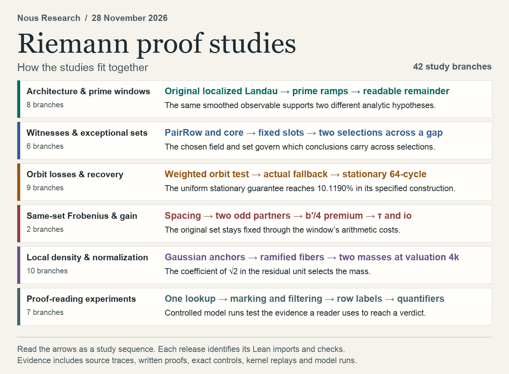

# Riemann proof studies

42 experiment branches and 9 additional editions or substudies. Links are pinned to the Git state audited on 2026-11-26.

[Open the branch index below](#studies-by-research-question) · [Download the searchable HTML map](research-map.html) · [Machine-readable index](study-index.json) · [Older research ZIPs](legacy-packages/README.md)

## Where to start

- To understand the common analytic observable, read the [windows and remainder study](https://github.com/nousentllc/riemann-hypothesis/tree/43141b319692e076cd6f6132534a3bec9f86fa39/research/uriel/experiments/window-remainder-architecture) and the [joint critical edition](https://github.com/nousentllc/riemann-hypothesis/tree/43141b319692e076cd6f6132534a3bec9f86fa39/research/uriel/experiments/proof-interfaces-critical-edition).
- To follow one arithmetic choice, start at [PairRow and the core](https://github.com/nousentllc/riemann-hypothesis/tree/bafda6a5728eb08b601943f0c9cb1d38d27c03a9/research/uriel/experiments/joint-witness), then read the [fixed-datum study](https://github.com/nousentllc/riemann-hypothesis/tree/43141b319692e076cd6f6132534a3bec9f86fa39/research/uriel/experiments/fixed-datum-host-expanded) and [selected-place transport](https://github.com/nousentllc/riemann-hypothesis/tree/43141b319692e076cd6f6132534a3bec9f86fa39/research/uriel/experiments/selected-place-transport-expanded).
- To reproduce a standalone local theorem, read [the ramified Gram-fiber bridge](https://github.com/nousentllc/riemann-hypothesis/tree/63c06fe44eb700e4550e4a2b70adafe09cb1ff9b/research/uriel/experiments/ramified-gram-bridge) and [the square-dilate extension](https://github.com/nousentllc/riemann-hypothesis/tree/17263859a4d27c62cfc67571737355f61a080806/research/uriel/experiments/ramified-square-dilates).

## Latest result

The written theorem jointly chooses a prime and good orbit on the original weighted host while keeping the retained set fixed. The lift-summed premium pays the original tau and any fixed nonnegative multiple of io with at least mb′/4 left. Six Lean modules check source accounting, predecessors, finite budgets, ramps and transport. The late asymptotic choice and Fourier strip estimate are written arguments.

[Paper, replay and controls](https://github.com/nousentllc/riemann-hypothesis/tree/80555206be28204b1d0a9063f54c8f1e2b5fd70d/research/uriel/experiments/frobenius-window-survival) · [Commit 8055520](https://github.com/nousentllc/riemann-hypothesis/commit/80555206be28204b1d0a9063f54c8f1e2b5fd70d)

## How the tracks connect

The cohomology and host studies identify which data the original arithmetic estimates share. The orbit studies quantify one cost of that selection. The Frobenius studies carry a different gain comparison through later arithmetic terms on one host. The local-density studies follow automorphic normalization inputs at a finite place. The model studies test how readers handle incomplete records.

These links describe reading order and mathematical context. Each release states its own import dependencies and the scope of its formal replay.

## Studies by research question

### Proof architecture & prime windows

What signal would an off-line zero force, and where does the arithmetic bound it?

The two source editions share a smoothed observable and a nonvanishing endpoint. Coefficient, quantifier, and scale changes govern what each interface transports.

| Study | Question or result | Commit |
| --- | --- | --- |
| [Initial five probes](https://github.com/nousentllc/riemann-hypothesis/tree/829e7bd067dc35da7a6c5085e45abc00d4e5d0b3/research/uriel/experiments/initial) | Localized Landau, error scaling, exceptional intervals, covolumes and proof dependencies. | [`829e7bd`](https://github.com/nousentllc/riemann-hypothesis/commit/829e7bd067dc35da7a6c5085e45abc00d4e5d0b3) |
| [Localized window replay](https://github.com/nousentllc/riemann-hypothesis/tree/b616d08a805e05e358ad0d2b3cd7b180e058a19e/research/uriel/experiments/second) | Rebuilds 30 modules for the analytic implication from one-sided windows to a zero-free region. | [`b616d08`](https://github.com/nousentllc/riemann-hypothesis/commit/b616d08a805e05e358ad0d2b3cd7b180e058a19e) |
| [Stable-range theta lifts](https://github.com/nousentllc/riemann-hypothesis/tree/003f8090b9894fb955d0925ea1b7f7da64a823c3/research/uriel/experiments/stable-range-theta) | Traces why the arithmetic argument uses two nonzero theta lifts. | [`003f809`](https://github.com/nousentllc/riemann-hypothesis/commit/003f8090b9894fb955d0925ea1b7f7da64a823c3) |
| [Siegel–Weil constant term](https://github.com/nousentllc/riemann-hypothesis/tree/2c03d15e908bcbe4aae3c94a87c7ada402cd7911/research/uriel/experiments/siegel-weil-constant-term) | Follows the normalization and rank split behind the factors one and two. | [`2c03d15`](https://github.com/nousentllc/riemann-hypothesis/commit/2c03d15e908bcbe4aae3c94a87c7ada402cd7911) |
| [A zero and the prime windows](https://github.com/nousentllc/riemann-hypothesis/tree/b7b5bc6e5e6814f654753fcbd5f45fecf370344c/research/uriel/experiments/zero-and-arithmetic-windows) | Traces the smoothed prime observable and tests manufactured signals and actual prime powers. | [`b7b5bc6`](https://github.com/nousentllc/riemann-hypothesis/commit/b7b5bc6e5e6814f654753fcbd5f45fecf370344c) |
| [Cofinal endpoints](https://github.com/nousentllc/riemann-hypothesis/tree/d79bd956c6fb2b8a3de51b606765be81d24fb1fc/research/uriel/experiments/cofinal-endpoint-certificates) | Separates endpoint certificates from control on the interval between them. | [`d79bd95`](https://github.com/nousentllc/riemann-hypothesis/commit/d79bd956c6fb2b8a3de51b606765be81d24fb1fc) |
| [Exceptional bands](https://github.com/nousentllc/riemann-hypothesis/tree/5396aa19afa70189268f80237c7897cdce426e24/research/uriel/experiments/exceptional-band-mass) | Measures positive prime mass inside bands and traces what survives a failed exceptional-integer test. | [`5396aa1`](https://github.com/nousentllc/riemann-hypothesis/commit/5396aa19afa70189268f80237c7897cdce426e24) |
| [Windows and prime remainder](https://github.com/nousentllc/riemann-hypothesis/tree/43141b319692e076cd6f6132534a3bec9f86fa39/research/uriel/experiments/window-remainder-architecture) | Compares the original cofinal windows with the readable eventual remainder bound. | [`43141b3`](https://github.com/nousentllc/riemann-hypothesis/commit/43141b319692e076cd6f6132534a3bec9f86fa39) |
| [Common interfaces](https://github.com/nousentllc/riemann-hypothesis/tree/43141b319692e076cd6f6132534a3bec9f86fa39/research/uriel/experiments/upstream-interface-comparison) | Source-edition comparison before the joint critical edition. | [`43141b3`](https://github.com/nousentllc/riemann-hypothesis/commit/43141b319692e076cd6f6132534a3bec9f86fa39) |
| [Joint critical edition](https://github.com/nousentllc/riemann-hypothesis/tree/43141b319692e076cd6f6132534a3bec9f86fa39/research/uriel/experiments/proof-interfaces-critical-edition) | Derives the positive-coefficient consequence at fixed exponent slack and reconciles the original target-four mass with the matched readable convention. | [`43141b3`](https://github.com/nousentllc/riemann-hypothesis/commit/43141b319692e076cd6f6132534a3bec9f86fa39) |

### Arithmetic witnesses & exceptions

Which conclusions keep the same field, host, retained set, and exceptional data?

Distinguishing existence from identification explains why a bound can hold even when the record cannot decide whether a particular integer belongs to its chosen exception list.

| Study | Question or result | Commit |
| --- | --- | --- |
| [One PairRow and one host](https://github.com/nousentllc/riemann-hypothesis/tree/bafda6a5728eb08b601943f0c9cb1d38d27c03a9/research/uriel/experiments/joint-witness) | Follows the exceptional interval and prime row into the same arithmetic core. | [`bafda6a`](https://github.com/nousentllc/riemann-hypothesis/commit/bafda6a5728eb08b601943f0c9cb1d38d27c03a9) |
| [Slot three, specified centers](https://github.com/nousentllc/riemann-hypothesis/tree/4b1c9fbbfb9bc50a3f791c2c1f3d7f2adb336c87/research/uriel/experiments/slot-three) | At cutoff 64, two valid single-center witnesses disagree on whether weight 1 is exceptional. | [`4b1c9fb`](https://github.com/nousentllc/riemann-hypothesis/commit/4b1c9fbbfb9bc50a3f791c2c1f3d7f2adb336c87) |
| [Class ascent over Q(ζ₃)](https://github.com/nousentllc/riemann-hypothesis/tree/e674cb750ef96b2f5e7cd46586ea4edb9998715a/research/uriel/experiments/ascent-witness) | Discharges the class-number assumption and formalizes non-unique exceptional sets. | [`e674cb7`](https://github.com/nousentllc/riemann-hypothesis/commit/e674cb750ef96b2f5e7cd46586ea4edb9998715a) |
| [Selection on one retained host](https://github.com/nousentllc/riemann-hypothesis/tree/9ac7e1b546b132edde02709e1c0af1bfccd40755/research/uriel/experiments/retained-host) | Tests coset shares and character bounds on the same set. | [`9ac7e1b`](https://github.com/nousentllc/riemann-hypothesis/commit/9ac7e1b546b132edde02709e1c0af1bfccd40755) |
| [Two selections across a gap](https://github.com/nousentllc/riemann-hypothesis/tree/0b9ed6f42cccf214e7e196f2e129ea1e3b1b5987/research/uriel/experiments/prescribed-gap-witnesses) | Spells out the coherence and crossover conditions needed for a prescribed gap. | [`0b9ed6f`](https://github.com/nousentllc/riemann-hypothesis/commit/0b9ed6f42cccf214e7e196f2e129ea1e3b1b5987) |
| [Fixed slot at seven](https://github.com/nousentllc/riemann-hypothesis/tree/4f0a1148df04b3f12ea05431b20165880342b11b/research/uriel/experiments/cyclotomic-slot-seven) | Shows vanishing at fixed slots 3 and 7 and isolates the moving field tests at 2. | [`4f0a114`](https://github.com/nousentllc/riemann-hypothesis/commit/4f0a1148df04b3f12ea05431b20165880342b11b) |
| [Recovering the arithmetic witness](https://github.com/nousentllc/riemann-hypothesis/tree/43141b319692e076cd6f6132534a3bec9f86fa39/research/uriel/experiments/fixed-datum-host-expanded) | Traces a fixed readable datum, its prime partition, and the constraints of transporting the same original witness. | [`43141b3`](https://github.com/nousentllc/riemann-hypothesis/commit/43141b319692e076cd6f6132534a3bec9f86fa39) |
| [Selected places and signed indices](https://github.com/nousentllc/riemann-hypothesis/tree/43141b319692e076cd6f6132534a3bec9f86fa39/research/uriel/experiments/selected-place-transport-expanded) | Checks capacity and conditional coset transport at q₀ = 18480 and d = 9239. | [`43141b3`](https://github.com/nousentllc/riemann-hypothesis/commit/43141b319692e076cd6f6132534a3bec9f86fa39) |

### Orbit losses & recovery

How much of the original odd-position allowance can the fallback gain recover?

The 10.1190% stationary 64-cycle optimum and the supremum over growing compatible families quantify different constructions.

| Study | Question or result | Commit |
| --- | --- | --- |
| [Weighted orbit test](https://github.com/nousentllc/riemann-hypothesis/tree/4140d06dcda9a3e948395fb72b7333eb6ca9c1dd/research/uriel/experiments/weighted-orbit) | Two retained sets with equal coset shares can have opposite weighted orbit outcomes. | [`4140d06`](https://github.com/nousentllc/riemann-hypothesis/commit/4140d06dcda9a3e948395fb72b7333eb6ca9c1dd) |
| [Bad-orbit costs](https://github.com/nousentllc/riemann-hypothesis/tree/1f15c9441034d5d74949d25a498937653f6779a7/research/uriel/experiments/orbit-loss-trace) | Follows one weighted orbit change into the original omission and prime estimates. | [`1f15c94`](https://github.com/nousentllc/riemann-hypothesis/commit/1f15c9441034d5d74949d25a498937653f6779a7) |
| [Which primes are served?](https://github.com/nousentllc/riemann-hypothesis/tree/1d893ba17074fc74c4546e4a49e38af18f774829/research/uriel/experiments/served-prime-study) | Follows the effective weights for the high inert primes and the same host’s analytic bounds. | [`1d893ba`](https://github.com/nousentllc/riemann-hypothesis/commit/1d893ba17074fc74c4546e4a49e38af18f774829) |
| [Odd-position charge](https://github.com/nousentllc/riemann-hypothesis/tree/ab18d856b6989f7bcb05e486ca720aa9016f3268/research/uriel/experiments/odd-position-study) | Sharpens the principal conductor-one local allowance and tests compatible selections. | [`ab18d85`](https://github.com/nousentllc/riemann-hypothesis/commit/ab18d856b6989f7bcb05e486ca720aa9016f3268) |
| [Actual gain against the fallback](https://github.com/nousentllc/riemann-hypothesis/tree/3dedd2d81a54d046e3c12ef78df9d9fd0c2ad6dc/research/uriel/experiments/actual-gain-study) | Holds prime, orbit, and lift fixed and compares the clipped competing gains. | [`3dedd2d`](https://github.com/nousentllc/riemann-hypothesis/commit/3dedd2d81a54d046e3c12ef78df9d9fd0c2ad6dc) |
| [Recovery under the original score](https://github.com/nousentllc/riemann-hypothesis/tree/a71afc29237a4b0ae379ff8be7d58310afb80d99/research/uriel/experiments/incumbent-recovery-study) | Includes a compatible long-orbit construction recovering 2/45 of its odd-position allowance. | [`a71afc2`](https://github.com/nousentllc/riemann-hypothesis/commit/a71afc29237a4b0ae379ff8be7d58310afb80d99) |
| [Recovery frontier](https://github.com/nousentllc/riemann-hypothesis/tree/f667dea291ef2a5b204810ad63611ef6b718b18a/research/uriel/experiments/recovery-frontier) | Separates an asymptotic supremum over compatible choices from finite uniform templates. | [`f667dea`](https://github.com/nousentllc/riemann-hypothesis/commit/f667dea291ef2a5b204810ad63611ef6b718b18a) |
| [A hand certificate for ten percent](https://github.com/nousentllc/riemann-hypothesis/tree/d67de1f6716496b98c8f0eb9f16b2a38c4f789c4/research/uriel/experiments/ten-percent-study) | A 64-cycle construction guarantees 12087/120814 for every labeling in its stated setting. | [`d67de1f`](https://github.com/nousentllc/riemann-hypothesis/commit/d67de1f6716496b98c8f0eb9f16b2a38c4f789c4) |
| [64-cycle optimization](https://github.com/nousentllc/riemann-hypothesis/tree/4f6f7767efdff49863210284eeca23353cd7ffa9/research/uriel/experiments/cycle64-optimization) | Matches the bounds for stationary profiles in the specified host construction at 10.11902517624%. | [`4f6f776`](https://github.com/nousentllc/riemann-hypothesis/commit/4f6f7767efdff49863210284eeca23353cd7ffa9) |

### Same-set Frobenius & gain

Can the original selector admit two odd partners on the same set, and can their gain survive the original window charges?

The newest study keeps the weighted host and retained set fixed through an existential prime-and-orbit selection. Six Lean components check local and transport steps. The final late selection is written.

| Study | Question or result | Commit |
| --- | --- | --- |
| [Original versus compact spacing](https://github.com/nousentllc/riemann-hypothesis/tree/d5cdf95bdb5634d812782c464e799f8f5d0546ee/research/uriel/experiments/frobenius-spacing) | Finds a rank obstruction at fixed d and contrasts the original local clauses with compact uniqueness. | [`d5cdf95`](https://github.com/nousentllc/riemann-hypothesis/commit/d5cdf95bdb5634d812782c464e799f8f5d0546ee) |
| [Frobenius premium in the arithmetic window](https://github.com/nousentllc/riemann-hypothesis/tree/80555206be28204b1d0a9063f54c8f1e2b5fd70d/research/uriel/experiments/frobenius-window-survival) | Traces the lift-summed premium through original tauAt and ioAt on one weighted host. | [`8055520`](https://github.com/nousentllc/riemann-hypothesis/commit/80555206be28204b1d0a9063f54c8f1e2b5fd70d) |
| [Two odd Frobenius partners](https://github.com/nousentllc/riemann-hypothesis/tree/80555206be28204b1d0a9063f54c8f1e2b5fd70d/research/uriel/experiments/global-frobenius) | Lets d vary and studies two distinct odd partners in the unchanged retained set. | [`8055520`](https://github.com/nousentllc/riemann-hypothesis/commit/80555206be28204b1d0a9063f54c8f1e2b5fd70d) |
| [Same-set positive gain](https://github.com/nousentllc/riemann-hypothesis/tree/80555206be28204b1d0a9063f54c8f1e2b5fd70d/research/uriel/experiments/frobenius-gain-gates) | Follows that collision through selection, pricing, and the b′/4 row margin. | [`8055520`](https://github.com/nousentllc/riemann-hypothesis/commit/80555206be28204b1d0a9063f54c8f1e2b5fd70d) |

### Local density & normalization

How do finite counts become fiber measures, and how does local mass enter Siegel–Weil?

Track the modulus, vector lattice, and Haar convention alongside each number. Ramified target four is 257/128 in scalar normalization and 257/256 in the matched split-skew normalization.

| Study | Question or result | Commit |
| --- | --- | --- |
| [Rank-one growth](https://github.com/nousentllc/riemann-hypothesis/tree/609877747df336e925a39085acf02c8f994f66a3/research/uriel/experiments/rank-one-growth) | Audits a finite-place growth witness and checks independent six-square counts. | [`6098777`](https://github.com/nousentllc/riemann-hypothesis/commit/609877747df336e925a39085acf02c8f994f66a3) |
| [Dyadic fiber](https://github.com/nousentllc/riemann-hypothesis/tree/0cce5c50f1468cc7519e6eb2e18386556c4cfdd8/research/uriel/experiments/dyadic-fiber) | Follows one Gaussian density through the source’s input, target, and fiber conventions. | [`0cce5c5`](https://github.com/nousentllc/riemann-hypothesis/commit/0cce5c50f1468cc7519e6eb2e18386556c4cfdd8) |
| [Gaussian target one](https://github.com/nousentllc/riemann-hypothesis/tree/49feb57ded97dfd384aae1c86538df32fea856a9/research/uriel/experiments/gaussian-target-one) | Checks 3/4 in the original Gram-fiber setting and constructs normalized data. | [`49feb57`](https://github.com/nousentllc/riemann-hypothesis/commit/49feb57ded97dfd384aae1c86538df32fea856a9) |
| [Gaussian target four](https://github.com/nousentllc/riemann-hypothesis/tree/b4d12e0825d2191f38fdfb5e97b327c8c8ad1b3d/research/uriel/experiments/gaussian-target-four) | Checks 63/64, separating primitive 15/16 from all-even 3/64. | [`b4d12e0`](https://github.com/nousentllc/riemann-hypothesis/commit/b4d12e0825d2191f38fdfb5e97b327c8c8ad1b3d) |
| [Growth on a progression](https://github.com/nousentllc/riemann-hypothesis/tree/e3bf793943ea2f2eab748816b974a8a0c11bdbbe/research/uriel/experiments/parallel-growth) | Establishes a bounded-gap progression and traces its use in the rank-one normalization. | [`e3bf793`](https://github.com/nousentllc/riemann-hypothesis/commit/e3bf793943ea2f2eab748816b974a8a0c11bdbbe) |
| [Exact support and uncapped growth](https://github.com/nousentllc/riemann-hypothesis/tree/12695d4031eea7e561515ac92758a487d6d48ac5/research/uriel/experiments/uncapped-growth) | Identifies divisibility support for the finite-place product and growth throughout that support. | [`12695d4`](https://github.com/nousentllc/riemann-hypothesis/commit/12695d4031eea7e561515ac92758a487d6d48ac5) |
| [Ramified reading and literature](https://github.com/nousentllc/riemann-hypothesis/tree/b040ed9063835e90efdecd1e4350ed35708317c0/research/uriel/experiments/uncapped-growth) | Compares ramified finite counts and lifting with prior density methods in a supplement. | [`b040ed9`](https://github.com/nousentllc/riemann-hypothesis/commit/b040ed9063835e90efdecd1e4350ed35708317c0) |
| [Ramified Gram fiber](https://github.com/nousentllc/riemann-hypothesis/tree/63c06fe44eb700e4550e4a2b70adafe09cb1ff9b/research/uriel/experiments/ramified-gram-bridge) | Checks 257/128 in the original measure at the named ramified dyadic place. | [`63c06fe`](https://github.com/nousentllc/riemann-hypothesis/commit/63c06fe44eb700e4550e4a2b70adafe09cb1ff9b) |
| [Ramified square dilates](https://github.com/nousentllc/riemann-hypothesis/tree/17263859a4d27c62cfc67571737355f61a080806/research/uriel/experiments/ramified-square-dilates) | Checks 2 + 2/256ᵏ at 4ᵏu² for k ≥ 1 and units u, including target sixteen. | [`1726385`](https://github.com/nousentllc/riemann-hypothesis/commit/17263859a4d27c62cfc67571737355f61a080806) |
| [Target-four Haar and valuation strata](https://github.com/nousentllc/riemann-hypothesis/tree/25a06cea18926d375c63cf45d51693a98d821cae/research/uriel/experiments/target-four-haar) | Compares two conventions and accounts for the entire 1/128 excess by vectors divisible by two. | [`25a06ce`](https://github.com/nousentllc/riemann-hypothesis/commit/25a06cea18926d375c63cf45d51693a98d821cae) |
| [Regular chart at 4i](https://github.com/nousentllc/riemann-hypothesis/tree/25a06cea18926d375c63cf45d51693a98d821cae/research/uriel/experiments/target-four-regular-chart) | Tests narrower physical boxes while the integral trace-one obstruction persists. | [`25a06ce`](https://github.com/nousentllc/riemann-hypothesis/commit/25a06cea18926d375c63cf45d51693a98d821cae) |
| [Two pivots on one fiber](https://github.com/nousentllc/riemann-hypothesis/tree/25a06cea18926d375c63cf45d51693a98d821cae/research/uriel/experiments/target-four-chart-overlap) | Shows chart agreement on the overlap and a second branch when the box widens. | [`25a06ce`](https://github.com/nousentllc/riemann-hypothesis/commit/25a06cea18926d375c63cf45d51693a98d821cae) |

### Proof-reading experiments

When does an agent certify a verdict, guess, or abstain from an incomplete record?

These are model experiments with recorded controls. Their scores measure reader behavior on the tested panels.

| Study | Question or result | Commit |
| --- | --- | --- |
| [One lookup](https://github.com/nousentllc/riemann-hypothesis/tree/42b3ce4890b5c6a584af26d34bbc54f177517871/research/uriel/experiments/binary-proof-audit-transfer) | Moves from a binary measure proof trace to a separately scored follow-up observation experiment. | [`42b3ce4`](https://github.com/nousentllc/riemann-hypothesis/commit/42b3ce4890b5c6a584af26d34bbc54f177517871) |
| [Threshold diagnostic](https://github.com/nousentllc/riemann-hypothesis/tree/90729bccc20c8f941bb79494861702259bcaddbb/research/uriel/experiments/circuit-threshold-diagnostic) | Tests whether explicit threshold comparisons affect the choice of observation. | [`90729bc`](https://github.com/nousentllc/riemann-hypothesis/commit/90729bccc20c8f941bb79494861702259bcaddbb) |
| [Decisive reading](https://github.com/nousentllc/riemann-hypothesis/tree/03854270b77458b2b8f30e74049c142d9bb3c3a1/research/uriel/experiments/forced-reading-audit) | Tests identical circuits with eight candidates versus the two compatible candidates. | [`0385427`](https://github.com/nousentllc/riemann-hypothesis/commit/03854270b77458b2b8f30e74049c142d9bb3c3a1) |
| [Mark versus filter](https://github.com/nousentllc/riemann-hypothesis/tree/2462c0f0b4b7c34052121dacab60833d58b34c4a/research/uriel/experiments/marked-reading-audit) | Compares unmarked, marked, and filtered views of the same records. | [`2462c0f`](https://github.com/nousentllc/riemann-hypothesis/commit/2462c0f0b4b7c34052121dacab60833d58b34c4a) |
| [Label before deciding](https://github.com/nousentllc/riemann-hypothesis/tree/e7a01b2d19e61e77b97ece9f1b48d48bb761e186/research/uriel/experiments/label-first-verdict) | Measures whether a verdict follows two accurately transcribed labels. | [`e7a01b2`](https://github.com/nousentllc/riemann-hypothesis/commit/e7a01b2d19e61e77b97ece9f1b48d48bb761e186) |
| [At least one versus both](https://github.com/nousentllc/riemann-hypothesis/tree/4288df5b22461eee3ad77a15802f80b53a6be527/research/uriel/experiments/quantifier-scope) | Separately asks two questions on mixed and unanimous pairs. | [`4288df5`](https://github.com/nousentllc/riemann-hypothesis/commit/4288df5b22461eee3ad77a15802f80b53a6be527) |
| [Checkpoint intervention](https://github.com/nousentllc/riemann-hypothesis/tree/4d4869956c394f4e2279765baf84a4d431f3e63e/research/uriel/experiments/checkpoint-intervention) | Replays five historical cases after an explicit one-character repair to a report. | [`4d48699`](https://github.com/nousentllc/riemann-hypothesis/commit/4d4869956c394f4e2279765baf84a4d431f3e63e) |
| [Shortcut diagnostic](https://github.com/nousentllc/riemann-hypothesis/tree/42b3ce4890b5c6a584af26d34bbc54f177517871/research/uriel/experiments/binary-proof-audit-transfer/diagnostics) | Probes regularities in the choice of measurement separately from verdict certification. | [`42b3ce4`](https://github.com/nousentllc/riemann-hypothesis/commit/42b3ce4890b5c6a584af26d34bbc54f177517871) |

## Evidence and provenance

- The studies distinguish exact finite controls, written deductions from the archived source, and local Lean kernel replays. Read the evidence and verification sections at each release for its hypotheses, pins, and limits.
- The initial source reading is in [PROOF_CONTEXT.md](../PROOF_CONTEXT.md) with declaration anchors in [SOURCE_TRACE.json](../SOURCE_TRACE.json).
- The branch list verifies where the studies were published. Ten GitHub ZIPs matched the local release copies byte for byte. Each archive contained one TeX source and its PDF. Their Git blob hashes are in the [machine-readable index](study-index.json).
- The study replays are documented in the linked releases. This portfolio audit verified publication and package identity.
- Baseline `baseline/published-2026-11-20` · [`40e56ba`](https://github.com/nousentllc/riemann-hypothesis/tree/40e56bab026552e089d7afcfeff08d2defb9c005).
- Baseline `baseline/community-2026-11-22` · [`c259b55`](https://github.com/nousentllc/riemann-hypothesis/tree/c259b55f5b1e0c29f82abf235e21a48ad2f9e34e).
- Baseline `baseline/community-2026-11-25` · [`e063a92`](https://github.com/nousentllc/riemann-hypothesis/tree/e063a923620ee7787b4a1270421478645bf66bdb).

## Rebuild the index

Run `python3 build_portfolio.py` from this folder with Pillow installed. The [generator](build_portfolio.py) reads `study-index.json` and writes this README, the HTML, and the PNG. An optional `--font-dir` points to the Georgia and Arial fonts or to DejaVu Serif and Sans.
